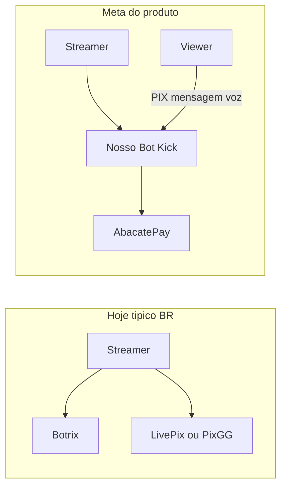
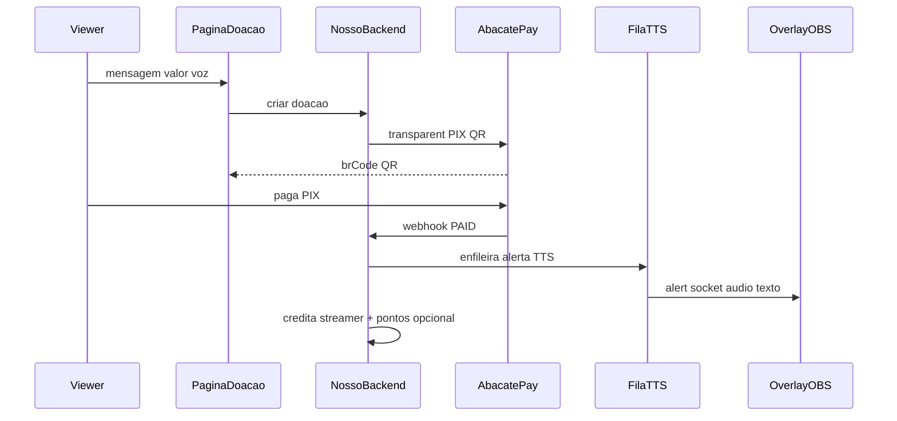

# Projeção futura — Bot Kick all-in-one (BR)

## Objetivo norte

Consolidar **uma única plataforma** para o streamer Kick brasileiro: bot de chat + overlays + engajamento + **doações PIX com voz** + (depois) interações no jogo — reduzindo a necessidade de pagar/configurar Botrix + LivePix/PixGG em separado, com taxas mais competitivas via [AbacatePay](https://docs.abacatepay.com/pages/start/welcome).

---

## 1. Benchmark Botrix — o que já temos vs o mínimo para ser comparável

Fontes: [botrix.live](https://botrix.live/), reviews de mercado (alerts/widgets OBS, antispam, commands, timers, points/levels, giveaways, cloud, OAuth multi-plataforma). Docs públicas do Botrix são rasas; o pacote “mínimo Kick” é inferido do site + uso real (alerts follow/sub no OBS).

| Capacidade Botrix (mínimo)                 | Nosso status atual                                                                                            | Gap                                                                              |
| ------------------------------------------ | ------------------------------------------------------------------------------------------------------------- | -------------------------------------------------------------------------------- |
| Cloud / sem instalar bot local             | Parcial: processo Node single-channel (`KICK_CHANNEL_SLUG`)                                                   | Multi-tenant cloud + onboarding OAuth Kick no dashboard                          |
| Login OAuth Kick (sem senha compartilhada) | Dashboard = senha JWT admin                                                                                   | Conta streamer via Kick OAuth                                                    |
| Moderação antispam/links/caps              | Existe (`[moderationService.ts](c:/Users/JailsonPaiva/Desktop/bot_kick/src/moderation/moderationService.ts)`) | Strike system, only-live, symbols/emote spam, permit list                        |
| Comandos custom + variáveis                | Existe (`{user}`, `{count}`, `{date}`, `{uptime}`)                                                            | `!uptime` real da live, `{touser}`, `{query}`, random reply, counters/quotes     |
| Timers                                     | Existe                                                                                                        | `minViewers` (já no schema), only-when-live, chat-lines mínimo                   |
| Points / levels                            | Pontos por chat + eventos webhook                                                                             | Watch-time real (`WatchSession` no schema sem uso), levels/roles, loja de redeem |
| Giveaways                                  | Forte (peso subs, modos comando/chat)                                                                         | Follow real, multi-winner, blacklist                                             |
| Widgets / alerts OBS                       | Overlay Socket.IO básico                                                                                      | Widgets separados (chat, goal bar, sub goal), áudio nativo, tip/donation         |
| Discord notifications                      | Não                                                                                                           | Opcional pós-MVP                                                                 |
| Multi-plataforma (Twitch/YT)               | Só Kick                                                                                                       | Fora do escopo inicial (foco Kick)                                               |

**Já competitivos / acima do mínimo em alguns pontos:** sorteios avançados, polls com peso, chat ao vivo no painel, OpenAPI, TTT híbrido chat/web, loyalty configurável por evento.

**Diferenciação de valor (além da paridade):** PIX+voz nativo, taxas menores que LivePix, loja de interação no jogo (com segurança), produto 100% BR/Kick.

### Pacote “paridade Botrix” (P0 — fundação comercial)

1. **Multi-canal + OAuth Kick no dashboard** (substituir senha única; usar model `Channel` já preparado).
2. **Comandos utilitários padrão:** `!commands`, `!uptime` (API Kick live), `!followage` quando API permitir, contadores.
3. **Loyalty v2:** pontos por watch-time; levels; loja simples (redeem título / destaque / som).
4. **Timers condicionais:** only-live + `minViewers`.
5. **Overlays v2:** alertas com som; goal bar (follows/subs); widget de chat; URL por widget.
6. **Moderação v2:** strikes → timeout escalonado; logs filtráveis no UI.

Sem isso, o produto continua “bot técnico”; com isso, vira substituto razoável do Botrix no Kick.

---

## 2. Doações PIX + mensagem de voz (diferencial BR)

### Mercado

| Player                                           | Papel                                                         | Taxas públicas                                      | Docs                                                                      |
| ------------------------------------------------ | ------------------------------------------------------------- | --------------------------------------------------- | ------------------------------------------------------------------------- |
| [LivePix](https://docs.livepix.gg/api)           | Doação + TTS/áudio + fila + widgets OBS + API OAuth2/webhooks | **5% PIX**, 7% cartão; 3 saques/mês grátis          | API completa (mensagens, assinaturas, recompensas, controles skip/replay) |
| [PixGG](https://pixgg.com/)                      | Concorrente BR de doação                                      | Sem docs públicas encontradas                       | Integração fechada                                                        |
| [AbacatePay](https://www.abacatepay.com/pricing) | Gateway (PIX/cartão/boleto/assinatura)                        | **PIX R$ 0,80 fixo**/tx; saque R$ 0,80 (até 20/mês) | Checkout transparente + webhooks                                          |

**Proposta de valor numérica (exemplo):** doação R$ 50 → LivePix ~R$ 2,50 (5%); AbacatePay R$ 0,80 + nossa taxa de plataforma (ex.: 2% = R$ 1,00 → total ~R$ 1,80). Quanto maior a doação, maior a vantagem vs % do LivePix.

### Arquitetura recomendada (nativa, não “wrapper LivePix”)

**Escopo funcional (espelhar LivePix no essencial):**

- Página pública de doação por canal (QR + copia-e-cola).
- Mensagem de texto + opções: TTS (IA), áudio gravado (upload curto), depois mídia avançada.
- Fila no dashboard: pausar / pular / reexibir / mute (como controles LivePix API).
- Overlay OBS dedicado a doações (já temos pipeline Socket.IO em `[alertEvents.ts](c:/Users/JailsonPaiva/Desktop/bot_kick/src/api/alertEvents.ts)`).
- Config: valor mínimo, palavras bloqueadas, volume, voz, cooldown.
- Saque: streamer conecta conta AbacatePay (ou conta plataforma → payout); modelo de split a definir com compliance (conta marketplace vs subconta).

**Decisão de produto:** construir **módulo próprio** com AbacatePay como gateway. Integração LivePix (OAuth + webhook) fica só como **ponte de migração opcional**, não como core — senão o streamer continua dependente de duas marcas e taxas deles.

**Riscos a endereçar cedo:** KYC/AML, ToS Kick sobre monetização, moderação de áudio (ódio/PII), custo TTS (ElevenLabs/Azure/Google), disputa de chargeback (cartão), e modelo jurídico (quem é o merchant of record).

---

## 3. Interação viewer ↔ jogo (CS2 / LoL)

### Ideia original

Streamer cadastra teclas por ação; viewer “compra/resgata” ação; bot emite a tecla no PC (SendInput / companion).

### Avaliação técnica e de risco

| Abordagem                                                 | Viabilidade                                              | Risco anticheat / ToS                                                                                                                       |
| --------------------------------------------------------- | -------------------------------------------------------- | ------------------------------------------------------------------------------------------------------------------------------------------- |
| Simular tecla (SendInput, AHK, HID Arduino)               | Tecnicamente possível via **app companion local**        | **Alto** em CS2 (detecção “input automation” / kicks) e **muito alto** em LoL (Vanguard kernel). Pode gerar ban, kick ou percepção de cheat |
| API oficial do jogo                                       | CS2: Game State Integration (leitura); LoL: LCU limitado | Não há API oficial estável para “forçar flash” ou “dropar arma” em partida ranked                                                           |
| Overlay / cena OBS (efeito visual)                        | Fácil                                                    | Seguro; não altera o jogo                                                                                                                   |
| Mods / plugins em jogos single-player ou servers privados | Caso a caso                                              | Depende do ToS                                                                                                                              |

**Conclusão:** a abordagem de “emitir a mesma tecla do streamer” **não deve ser o caminho principal** para CS2 competitivo nem LoL. É o caminho mais óbvio de produto, mas o mais perigoso para a conta do streamer e para a reputação do bot.

### Abordagem recomendada (em camadas)

1. **P1 — Loja de interações “seguras” (sem input no jogo)**
  Catálogo pago (pontos ou PIX): TTS, alerta overlay, “missão no chat”, troca de cena OBS (via WebSocket → companion OBS), sons, highlight no chat. Reaproveita doações + loyalty.
2. **P2 — Companion desktop com allowlist e contexto**
  App local autenticado (como Stream Deck / Botrix não tem, mas StreamElements/SE.Live têm agentes). Streamer mapeia ações. Execução só quando:
  - modo explícito “interações ON”;
  - jogo/perfil allowlisted;
  - cooldown + fila + veto do streamer;
  - preferência por jogos **sem AC agressivo** ou modos custom/offline primeiro.
3. **P3 — Packs por jogo (com aviso legal)**
  - **CS2:** começar com GSI (HUD no overlay: “viewer pediu drop”) + ações só em **workshop/custom** se houver caminho seguro; **não** prometer ranked.  
  - **LoL:** evitar input automation; explorar apenas overlays / remakes de “pedido de flash” como alerta humorístico, ou parceiros oficiais se existirem.
4. **UX da “loja” vs comandos:** preferir **loja no overlay/página** (lista com preço + botão) + comando curto `!acao <id>` como atalho. Loja escala melhor (preço, cooldown, descrição, ícone); comando sozinho fica ilegível com dezenas de ações.

---

## 4. Roadmap por fases

### Fase A — Paridade comercial Botrix (Kick)

- OAuth multi-canal, comandos utilitários, loyalty watch-time + levels, overlays/widgets, moderação strikes, timers only-live.
- **Critério de saída:** streamer Kick consegue dropar Botrix para o dia a dia de chat/alertas/pontos/sorteios.

### Fase B — Monetização PIX+voz (substituir LivePix no stack)

- AbacatePay PIX transparente + webhook; página de doação; fila TTS; overlay; dashboard de controles; taxas configuráveis da plataforma.
- **Critério de saída:** streamer recebe PIX com voz só pelo nosso produto, com custo total menor que ~5% do LivePix na maioria dos valores.

### Fase C — Loja de engajamento unificada

- Redeem pontos + ações pagas por PIX na mesma loja; goals de meta; alertas de tip ligados a loyalty.

### Fase D — Companion + interações de jogo (com guarda-chuva de segurança)

- MVP companion + ações não-jogo; depois packs experimentais por título com disclaimer; CS2/LoL competitive fora do marketing até validação jurídica/técnica.

### Fase E — Expansão (opcional)

- Discord, analytics, multi-plataforma, assinaturas recorrentes AbacatePay, API pública estilo LivePix para terceiros.

---

## 5. Priorização do que “traz valor” além da paridade

Ordem sugerida de ROI no mercado BR Kick:

1. **PIX + voz nativo (AbacatePay)** — resolve dor de duas plataformas + argumento de taxa.
2. **Onboarding cloud OAuth** — sem isso não escala nem compete com Botrix.
3. **Overlays/widgets + fila de alertas madura** — percepção de produto “completo”.
4. **Loyalty loja / watch-time** — retenção de viewers.
5. **Companion de interações** — diferencial viral, mas só depois da base monetária e com framing de segurança.

---

## 6. Premissas adotadas neste plano

- Foco inicial **só Kick** (não Twitch/YouTube no curto prazo).
- Doações **nativas** via AbacatePay (LivePix só como migração opcional).
- Taxa da plataforma: modelo híbrido sugerido (ex. % baixo + piso) para caber acima do R$ 0,80 do gateway e ainda abaixo de 5%.
- Interação in-game **não** baseada em SendInput para jogos com AC forte como caminho de lançamento.

