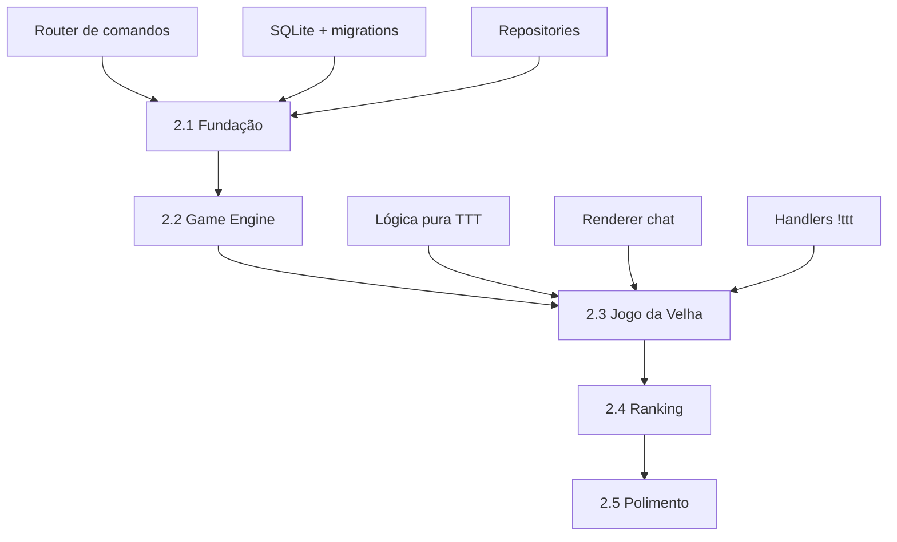

# Planejamento — Fase 2: Mini Games + Ranking

Documento de planejamento para evolução do Kick Bot após validação do MVP (OAuth, WebSocket e respostas no chat).

---

## Estado atual (baseline)

| Componente | Status |
|---|---|
| OAuth 2.1 + PKCE + refresh | ✅ |
| Leitura de chat (Pusher WebSocket) | ✅ |
| Envio de mensagens (API oficial) | ✅ |
| Comandos `!echo`, `!ping`, `!auth` | ✅ |
| Persistência de tokens (`.tokens.json`) | ✅ |
| Banco de dados | ❌ |
| Sistema de jogos | ❌ |
| Ranking | ❌ |

---

## Objetivo da Fase 2

Entregar o **jogo da velha (`!ttt`)** funcional no chat, com **ranking persistente** e arquitetura extensível para futuros mini games.

**Critério de sucesso:** streamer e viewer conseguem jogar uma partida completa via chat, pontos são salvos e consultáveis com `!rank`.

---

## Visão de arquitetura (evolução)

```
src/
├── auth/              (existente — sem mudanças grandes)
├── chat/              (existente — pequenos ajustes)
├── db/
│   ├── client.ts      SQLite connection + migrations
│   ├── migrations/    SQL versionado
│   └── repositories/  players, games, rankings
├── games/
│   ├── types.ts       interface MiniGame
│   ├── registry.ts    mapa comando → handler
│   ├── engine/
│   │   └── gameManager.ts   orquestra partidas ativas
│   └── ttt/
│       ├── tttGame.ts       lógica pura (grid, vitória, empate)
│       ├── tttCommands.ts   !ttt join, !ttt 5, etc.
│       └── tttRenderer.ts   tabuleiro formatado para chat
├── commands/
│   ├── parser.ts      extrai comando + args da mensagem
│   └── router.ts      despacha para echo ou games
├── config/
│   └── gameConfig.ts  timeouts, cooldowns, limites
├── utils/
└── bot.ts             entrypoint enxuto (só wiring)
```

**Princípio:** `bot.ts` deixa de ter lógica de comando; vira orquestrador que conecta chat → router → games/db.

---

## Fases de desenvolvimento

### Fase 2.1 — Fundação (infraestrutura)

**Estimativa:** 1–2 dias  
**Objetivo:** base técnica reutilizável antes de qualquer jogo.

#### Etapa 2.1.1 — Refatorar roteamento de comandos

- [x] Criar `commands/parser.ts` — parse de mensagens no formato `!comando [subcomando] [args]`
- [x] Criar `commands/router.ts` — registra handlers por prefixo (`echo`, `ping`, `auth`, `ttt`, `rank`)
- [x] Migrar handlers atuais de `bot.ts` para módulos dedicados
- [x] Manter compatibilidade com comandos MVP existentes

#### Etapa 2.1.2 — Configuração centralizada

- [x] Criar `config/gameConfig.ts` com valores padrão:
  - `GAME_TIMEOUT_MS` (ex: 5 min sem jogada)
  - `COMMAND_COOLDOWN_MS` (ex: 2s por usuário)
  - `MAX_ACTIVE_GAMES` (ex: 1 por canal)
- [x] Expor overrides opcionais via `.env`

#### Etapa 2.1.3 — SQLite + migrations

- [x] Adicionar dependência `better-sqlite3`
- [x] Criar `db/client.ts` com singleton e execução de migrations na inicialização
- [x] Arquivo de dados: `data/bot.db` (adicionar ao `.gitignore`)

**Schema inicial:**

```sql
-- players
CREATE TABLE players (
  id            INTEGER PRIMARY KEY AUTOINCREMENT,
  kick_user_id  INTEGER NOT NULL UNIQUE,
  username      TEXT NOT NULL,
  slug          TEXT NOT NULL,
  wins          INTEGER DEFAULT 0,
  losses        INTEGER DEFAULT 0,
  draws         INTEGER DEFAULT 0,
  points        INTEGER DEFAULT 0,
  created_at    TEXT NOT NULL,
  updated_at    TEXT NOT NULL
);

-- games (histórico)
CREATE TABLE games (
  id              TEXT PRIMARY KEY,  -- UUID
  game_type       TEXT NOT NULL,     -- 'ttt'
  channel_slug    TEXT NOT NULL,
  player_x_id     INTEGER NOT NULL,
  player_o_id     INTEGER NOT NULL,
  winner_id       INTEGER,           -- NULL = empate
  status          TEXT NOT NULL,     -- active | finished | abandoned
  board_state     TEXT,              -- JSON do grid final
  started_at      TEXT NOT NULL,
  finished_at     TEXT
);

-- game_moves (opcional, útil para replay/debug)
CREATE TABLE game_moves (
  id         INTEGER PRIMARY KEY AUTOINCREMENT,
  game_id    TEXT NOT NULL,
  player_id  INTEGER NOT NULL,
  position   INTEGER NOT NULL,
  created_at TEXT NOT NULL
);
```

#### Etapa 2.1.4 — Repositories

- [x] `PlayerRepository` — `findOrCreate(kickUserId, username, slug)`, `updateStats()`, `getTopN()`
- [x] `GameRepository` — `create()`, `finish()`, `findActiveByChannel()`

**Entregável 2.1:** bot inicia, roda migrations, comandos MVP continuam funcionando, banco pronto. ✅

---

### Fase 2.2 — Motor de jogos (engine)

**Estimativa:** 1 dia  
**Objetivo:** abstração para plugar qualquer mini game.

#### Etapa 2.2.1 — Interface `MiniGame`

```typescript
interface MiniGame {
  name: string;
  commands: string[];  // ['ttt']
  handle(ctx: GameContext): Promise<void>;
}
```

#### Etapa 2.2.2 — `GameManager` (estado em memória + persistência)

- [ ] Mapa `channelSlug → ActiveGame` para partidas em andamento
- [ ] Ao iniciar/finalizar partida → persiste no SQLite
- [ ] Timer de inatividade — cancela partida e anuncia no chat
- [ ] Impede múltiplas partidas simultâneas no mesmo canal

#### Etapa 2.2.3 — Anti-abuso básico

- [ ] Cooldown por `(userId, command)` em memória
- [ ] Ignorar spam de comandos inválidos (resposta curta, sem flood)

**Entregável 2.2:** engine pronto, ainda sem jogo implementado, mas testável com mock.

---

### Fase 2.3 — Jogo da velha (`!ttt`)

**Estimativa:** 2–3 dias  
**Objetivo:** primeiro mini game completo e jogável.

#### Regras do jogo

- Partida **1v1**: streamer (dono do canal) vs viewer
- **X** = quem iniciou (`!ttt join` ou desafio)
- **O** = oponente que aceita
- Grid 3×3, posições numeradas 1–9:

```
 1 | 2 | 3
---+---+---
 4 | 5 | 6
---+---+---
 7 | 8 | 9
```

#### Comandos propostos

| Comando | Ação |
|---|---|
| `!ttt` | Mostra ajuda / status da partida atual |
| `!ttt join` | Entra na fila ou aceita desafio pendente |
| `!ttt challenge @user` | Desafia um viewer específico (fase 2.3+) |
| `!ttt <1-9>` | Joga na posição |
| `!ttt forfeit` | Desiste da partida |
| `!ttt board` | Reexibe o tabuleiro |

#### Etapa 2.3.1 — Lógica pura (`tttGame.ts`)

- [ ] Estado: `board: (null | 'X' | 'O')[]`, `currentTurn`, `players`
- [ ] Validações: posição livre, turno correto, partida ativa
- [ ] Detecção: vitória (8 combinações), empate, jogo em andamento
- [ ] **Zero dependência de chat/API** — testável isoladamente

#### Etapa 2.3.2 — Renderer (`tttRenderer.ts`)

- [ ] Formatar tabuleiro ASCII/emoji para chat Kick (≤500 chars)
- [ ] Mensagens de turno: `@playerX, sua vez! Use !ttt 5`
- [ ] Anúncio de fim: vitória, empate, desistência

#### Etapa 2.3.3 — Commands handler (`tttCommands.ts`)

- [ ] Integrar com `GameManager` + `PlayerRepository`
- [ ] Fluxo mínimo:
  1. Viewer A: `!ttt join` → cria partida, espera oponente
  2. Viewer B: `!ttt join` → entra como O, inicia jogo
  3. Alternância de jogadas até fim
  4. Atualiza ranking e persiste histórico

#### Etapa 2.3.4 — Integração streamer vs viewer

- [ ] Identificar streamer pelo `broadcaster_user_id` ou slug do canal
- [ ] Opção A (simples): qualquer viewer pode jogar contra qualquer viewer
- [ ] Opção B (mais alinhada ao objetivo): streamer sempre é X, viewer desafiado é O
- [ ] **Recomendação:** começar com Opção A; evoluir para B na 2.3.4

**Entregável 2.3:** partida completa jogável no chat, com timeout e persistência.

---

### Fase 2.4 — Ranking e estatísticas

**Estimativa:** 1 dia  
**Objetivo:** gamificação básica.

#### Sistema de pontos (proposta)

| Resultado | Pontos |
|---|---|
| Vitória | +3 |
| Empate | +1 |
| Derrota | 0 |

#### Comandos

| Comando | Ação |
|---|---|
| `!rank` | Top 10 do canal |
| `!rank me` | Stats do jogador que digitou |
| `!rank @user` | Stats de um jogador específico |

#### Etapa 2.4.1 — Atualização automática pós-partida

- [ ] Ao finalizar jogo → `PlayerRepository.updateStats()` para ambos
- [ ] Registrar em `games` com `winner_id` e `board_state`

#### Etapa 2.4.2 — Formatação de ranking

- [ ] Mensagem compacta para chat (emoji + username + W/L/D + pontos)

**Entregável 2.4:** ranking persistente entre reinicializações do bot.

---

### Fase 2.5 — Polimento e robustez

**Estimativa:** 1–2 dias  
**Objetivo:** experiência estável para uso em live.

#### Etapa 2.5.1 — Recuperação de estado

- [ ] Ao reiniciar bot: carregar partidas `active` do SQLite e retomar (ou marcar como `abandoned`)
- [ ] Log claro: “Partida X recuperada” ou “Partida X cancelada por restart”

#### Etapa 2.5.2 — Mensagens e UX

- [ ] Padronizar prefixo `[BOT]` ou usar badge via `type: "bot"` quando configurado no Dev Portal
- [ ] Mensagens de erro amigáveis: “Posição 5 já ocupada”, “Não é sua vez”
- [ ] `!ttt help` com instruções curtas

#### Etapa 2.5.3 — Testes

- [ ] Testes unitários: `tttGame.ts` (vitória, empate, jogada inválida)
- [ ] Testes de integração: repositories SQLite (in-memory)
- [ ] Checklist manual em live (abaixo)

**Entregável 2.5:** bot pronto para uso recorrente em stream.

---

## Ordem de implementação recomendada



### Sequência prática (sprints)

| Sprint | Foco | Duração sugerida |
|---|---|---|
| Sprint 1 | 2.1 completo | 2 dias |
| Sprint 2 | 2.2 + 2.3.1–2.3.2 | 2 dias |
| Sprint 3 | 2.3.3–2.3.4 + 2.4 | 2 dias |
| Sprint 4 | 2.5 + testes em live | 1–2 dias |

---

## Checklist de testes em live (aceitação Fase 2)

- [ ] Dois viewers completam uma partida via `!ttt join` + jogadas
- [ ] Vitória detectada corretamente e anunciada
- [ ] Empate detectado corretamente
- [ ] `!ttt forfeit` encerra partida e concede vitória ao oponente
- [ ] Partida expira após timeout de inatividade
- [ ] `!rank` mostra pontos atualizados após partida
- [ ] Reiniciar bot não corrompe banco nem duplica partidas
- [ ] Bot ignora próprias mensagens
- [ ] Cooldown impede spam de comandos

---

## Dependências novas (Fase 2)

| Pacote | Uso |
|---|---|
| `better-sqlite3` | SQLite síncrono, simples |
| `@types/better-sqlite3` | Types (dev) |
| `uuid` | IDs de partida (ou `crypto.randomUUID()`) |

Manter stack alinhada ao MVP: TypeScript strict, sem ORM pesado.

---

## Riscos e mitigações

| Risco | Mitigação |
|---|---|
| Limite de 500 chars no chat | Tabuleiro compacto; mensagens curtas |
| Rate limit 429 | Fila sequencial já existe; evitar múltiplas respostas por comando |
| Partida órfã após crash | Timeout + recovery no boot |
| Streamer vs viewer confuso | Documentar regras no `!ttt help` |
| `type: "bot"` retorna 500 | Manter `type: "user"` até configurar bot no Dev Portal |

---

## Fase 3 (visão futura — fora do escopo imediato)

- Segundo mini game (ex: `!quiz`, `!duelo`)
- Desafio direto streamer ↔ viewer (`!ttt challenge`)
- Webhooks Kick (`events:subscribe`) como alternativa ao Pusher
- Dashboard web local (opcional)
- Deploy com Docker + volume para `bot.db`

---

## Próximo passo imediato

Recomenda-se começar pelo **Sprint 1 (Fase 2.1)**:

1. Refatorar `bot.ts` → router de comandos
2. Adicionar SQLite + schema
3. Garantir que `!ping` / `!echo` continuam funcionando

---

## Referências

- [Kick Dev Docs](https://docs.kick.com/)
- [README do projeto](../README.md) — setup e comandos MVP
- Arquitetura atual: `src/auth/`, `src/chat/`, `src/bot.ts`
